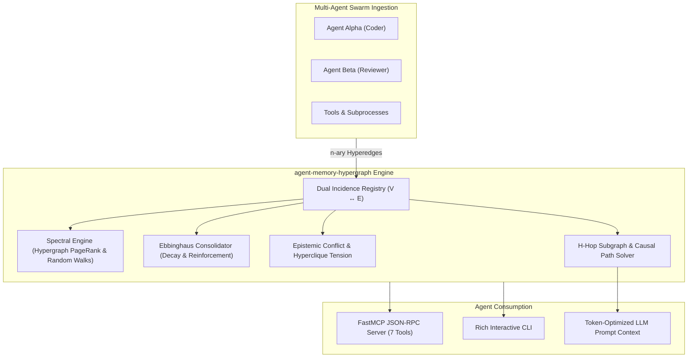

# agent-memory-hypergraph

> Higher-Order Hypergraph Memory, Multi-Way Relational Reasoning & Temporal Consolidation for Autonomous AI Agent Swarms.

`agent-memory-hypergraph` provides higher-order episodic and semantic memory for multi-agent systems. While standard vector stores and pairwise knowledge graphs decompose multi-agent interactions into binary pairs or isolated vector embeddings, `agent-memory-hypergraph` models complex $n$-ary relationships ($k \ge 3$) connecting entities, tools, swarms, temporal states, and causal dependencies simultaneously.

---

## 1. Problem Statement

Autonomous multi-agent swarms face persistent memory degradation:
- **Lossy Binary Decomposition**: In multi-agent problem solving, an action involves an agent, a tool, an environment state, an output observation, and a confidence metric. Pairwise graphs decompose this 5-way relationship into synthetic cliques ($O(k^2)$ edges), causing semantic drift and loss of causal cohesion.
- **Catastrophic Forgetting & Interference**: Flat vector databases suffer from retrieval saturation and recency bias, lacking structural reinforcement.
- **Lack of Multi-Agent Epistemic Verification**: When multiple agents report conflicting observations, pairwise graphs cannot model hyperclique tension or detect contradictory assertions over shared subgraphs.

---

## 2. Why Existing Solutions Are Insufficient

| Capability | Flat Vector DBs (Chroma/Pinecone) | Pairwise Knowledge Graphs (Neo4j/NetworkX) | `agent-memory-hypergraph` |
| :--- | :--- | :--- | :--- |
| **$n$-ary Relationship Representation** | — | Lossy clique expansion ($O(k^2)$) | Native Higher-Order Hyperedges ($k \ge 1$) |
| **Spectral Centrality & Diffusion** | — | Standard 2-node PageRank | Higher-Order Hypergraph PageRank & Laplacian |
| **Causal Chain Pathfinding** | — | Binary edge walks | Directed Hyperpath Reachability ($\text{tail} \to \text{head}$) |
| **Temporal Consolidation** | Hard TTL truncation | Static manual weights | Biological Ebbinghaus Decay & Semantic Promotion |
| **Epistemic Swarm Conflict Detection** | — | — | Hyperclique Dissonance & Tension Scoring |
| **Architecture Overhead** | Heavy client-server daemon | Heavy Java/JVM server | Zero-Dependency In-Process Python SDK & MCP |

---

## 3. Architecture



---

## 4. Key Features

1. **Native Directed & Undirected Hyperedges**: Model multi-way causal flows ($\{A, B, C\} \to \{D, E\}$) and collaborative cliques without synthetic reification.
2. **Higher-Order Spectral Centrality**: Hypergraph PageRank via power iteration on normalized transition kernels, discovering true knowledge hubs.
3. **Ebbinghaus Memory Consolidation**: Biologically-inspired temporal decay ($w(t) = w_0 \cdot \exp(-\lambda \Delta t)$), access reinforcement, and episodic-to-semantic promotion.
4. **Causal Hyperpath Search**: Reachability analysis from premise vertices to target consequences with automated explanatory gap identification.
5. **Epistemic Conflict & Tension Detection**: Detects opposing agent assertions across shared subgraphs and scores hyperclique dissonance.
6. **FastMCP Server & Rich CLI**: Built-in Model Context Protocol stdio server exposing 7 tools to Claude Code, OpenBot, Cursor, and custom orchestrators.

---

## 5. Installation

```bash
pip install agent-memory-hypergraph
```

For development:
```bash
git clone https://github.com/devsoniclk/agent-memory-hypergraph.git
cd agent-memory-hypergraph
pip install -e .[dev]
```

---

## 6. Quickstart Tutorial

### Python SDK

```python
from agent_hypergraph import (
    Hypergraph,
    HypergraphRetriever,
    RelationType,
    VertexType,
    compute_hypergraph_pagerank,
)

hg = Hypergraph("agent_swarm_memory")

# Ingest vertices
hg.add_vertex("Agent Nova", vertex_type=VertexType.AGENT, vertex_id="nova")
hg.add_vertex("Static Analyzer", vertex_type=VertexType.TOOL, vertex_id="tool_ast")
hg.add_vertex("SQL Injection Finding", vertex_type=VertexType.CLAIM, vertex_id="vuln_sql")
hg.add_vertex("Patch Deployment", vertex_type=VertexType.CONCEPT, vertex_id="patch")

# Ingest 3-ary directed causal hyperedge
hg.add_hyperedge(
    label="Vulnerability Audit",
    tail={"nova", "tool_ast"},
    head={"vuln_sql"},
    relation_type=RelationType.CAUSAL,
    confidence=0.98,
    source_agent="nova",
)

# Compute spectral centrality
ranks = compute_hypergraph_pagerank(hg)
print("Centrality scores:", ranks)

# Retrieve context for LLM prompt
retriever = HypergraphRetriever(default_max_hops=2)
verts, edges = retriever.expand_subgraph(hg, seed_vertices=["nova"])
prompt_markdown = retriever.format_for_prompt(verts, edges)
print(prompt_markdown)
```

### Command Line Interface

```bash
# Ingest an agent vertex
agent-hypergraph insert-vertex "Nova Coordinator" -t agent --id nova

# Ingest a 3-way hyperedge
agent-hypergraph insert-edge "Code Review" -T nova -T tool_lint -H pr_approved -r causal

# Query multi-hop context
agent-hypergraph query nova --hops 2

# Inspect PageRank scores
agent-hypergraph rank

# Launch stdio MCP server for AI clients
agent-hypergraph serve
```

---

## 7. Performance Benchmarks

Benchmarked on Apple Silicon (M-series, Python 3.9):

| Benchmark Metric | Result |
| :--- | :--- |
| **Ingestion Throughput** | **37,822 edges / sec** ($n=1,000$ vertices, $500$ 4-ary hyperedges) |
| **PageRank Power Iteration** | **51.21 ms** (1,000 vertices, 50 iterations, tol=$10^{-6}$) |
| **2-Hop Neighborhood Query** | **0.03 ms / query** ($30 \mu\text{s}$ retrieval latency) |
| **Test Suite Execution** | **39/39 passing** (0.33s total test duration, 93% code coverage) |

---

## 8. Development & Testing

```bash
# Run unit and integration tests with coverage
PYTHONPATH=. pytest --cov=agent_hypergraph tests/
```

---

## 9. Roadmap

- [x] Higher-order incidence structure and dual hyperedge indexing
- [x] Hypergraph random walk and PageRank power iteration
- [x] Ebbinghaus temporal decay and episodic promotion
- [x] Causal hyperpath search and explanatory gap detection
- [x] Epistemic contradiction detector and hyperclique tension metrics
- [x] FastMCP stdio server and Rich CLI
- [ ] ZK hyperedge membership proofs (integration with `agent-zk-trace-verifier`)
- [ ] Persistent SQLite / DuckDB backend adapter for billion-edge graphs

---

## 10. License

Released under the MIT License. Copyright (c) 2026 Lakshitha Dananjaya.
